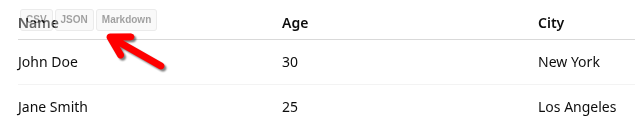

# Website Table Exporter

A browser extension that automatically adds export functionality to HTML tables on any website. Export tables to CSV, JSON, or Markdown format with a single click.



## ✨ Features

- **Universal compatibility**: Works on any website with HTML tables.
- **Multiple export formats**: CSV, JSON, and Markdown.
- **One-click export**: Export buttons appear automatically on all tables, even those dynamically created after page load.
- **Data type detection**: Automatically identifies columns that contain only numeric values (don't enclose those in quotes). Also identifies columns with values containing leading zeros (enclose those in quotes).
- **Clean formatting**: Properly handles line breaks, special characters, and HTML tags inside cells.
- **Privacy**: The extension is fully client-side. No ads, no tracking.
- **Toggle button visibility**: Hide/show export buttons via the extension popup.
- **Clipboard integration**: Exported data is copied directly to your clipboard.
- **Merged cell detection**: Warns users when tables contain merged cells that may affect export quality.


### Example Output

**CSV Format:**
```
"Name","Age","City"
"John Doe",30,"New York"
"Jane Smith",25,"Los Angeles"
```

**JSON Format:**
```json
[
  {
    "Name": "John Doe",
    "Age": 30,
    "City": "New York"
  },
  {
    "Name": "Jane Smith",
    "Age": 25,
    "City": "Los Angeles"
  }
]
```

**Markdown Format:**
```markdown
| Name | Age | City |
| --- | --- | --- |
| John Doe | 30 | New York |
| Jane Smith | 25 | Los Angeles |
```

## 🚀 Installation

### Mozilla Firefox

1. **Install from Firefox Add-ons**:
   - https://addons.mozilla.org/firefox/addon/website-table-exporter/

2. **Manual Installation** (for development):
   - Download or clone this repository
   - Open Firefox and navigate to `about:debugging`
   - Click "This Firefox" in the left sidebar
   - Click "Load Temporary Add-on"
   - Select the `manifest.json` file from the extension folder

### Google Chrome

1. **Manual Installation** (for development):
   - Download or clone this repository
   - Open Chrome and navigate to `chrome://extensions/`
   - Enable "Developer mode" (toggle in top right)
   - Click "Load unpacked" and select the extension folder

2. **Install from Chrome Web Store** (when published):

## 📖 How to Use

### Basic Export Functionality
1. **Navigate to any webpage** containing HTML tables
2. **Export buttons appear automatically** on each table:
   - **CSV**: Export as comma-separated values
   - **JSON**: Export as JSON array with header-based keys
   - **Markdown**: Export as Markdown table format
3. **Click any export button** to copy the data to your clipboard
4. **Paste the data** into your preferred application

### Toggle Button Visibility
1. **Click the extension icon** in your browser's toolbar to open the popup
2. **Click "Hide buttons"** to hide all export buttons from tables on the current page
3. **Click "Show buttons"** to make the buttons visible again
4. **Note**: This setting persists across page reloads and browser sessions

## 🎯 Use Cases

- **Data Analysis**: Quickly export website tables for analysis in Excel, Google Sheets, or other tools
- **Documentation**: Convert HTML tables to Markdown for documentation or README files
- **Research**: Extract data from research papers, reports, or statistical websites
- **Content Migration**: Move tabular data between different platforms and formats
- **API Development**: Export table data as JSON for testing or development purposes
- **Academic Work**: Extract data from academic databases and online resources

## 🤝 Contributing

Contributions are welcome! Please feel free to submit issues, feature requests, or pull requests.

## 📝 License

This project is open source. Please check the license file for more details.

**Project page** (this page): https://github.com/llagerlof/websitetableexporter

---


*Made with ❤️ for developers, researchers, and data enthusiasts*
